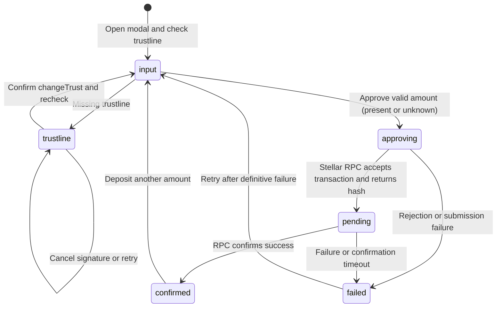

# Deposit flow

The `/billing` deposit modal signs transactions with Freighter and submits vault
deposits through Stellar RPC. Shared configuration lives in
`src/config/constants.ts`; wallet operations live in `src/services/walletService.ts`.
On-chain balance reads use `src/services/vaultReads.ts` and the `useVaultBalances`
hook in `src/hooks/useVaultBalances.ts`.

## Asset and network configuration

`STELLAR_USDC_ASSET` is `{ code: "USDC", issuer }`. The testnet default issuer is
`GDXDZNSTNORCX4373EGGYS4Q3U3XVZMBSIMMRHG5S5GCCF7JHC7QZWAZ`, whose Stellar Asset
Contract is `CAC7CFZ42L3LTTZCI4C3XI6UF7AHS2PYTNJ5QEG2PSLRGDGMWRQOZOT5`.
`VITE_STELLAR_USDC_ISSUER` overrides the issuer and is validated with
`StrKey.isValidEd25519PublicKey`. Mainnet and futurenet require an explicit issuer.
Invalid configuration blocks trustline and deposit actions before Horizon is called.
The configured vault must accept this asset; a public key alone cannot prove that
it matches the vault. See [Configuration](Configuration.md) and `.env.example`.

Freighter must use `STELLAR_NETWORK_PASSPHRASE`. `STELLAR_HORIZON_URL` selects the
same network for classic account lookups and trustline submission. Vault deposits
require `VITE_STELLAR_VAULT_CONTRACT_ID` and the configured Soroban RPC endpoint.

## On-chain balance reads

Balances are read via read-only Soroban simulation (no signatures, no ledger
writes):

- **Vault balance**: `vault.balance()` simulated against `STELLAR_VAULT_CONTRACT_ID`
- **USDC token**: `vault.get_usdc_token()` simulated once per session, cached
- **Wallet balance**: `balance(address)` simulated on the USDC Stellar Asset Contract

All three use `scValToNative` and keep stroops as `bigint` until formatting via
`formatUsdcStroops` (exact decimal, no `Number` conversion for values > 2^53).

The `useVaultBalances({ address })` hook returns:
- `vault` / `wallet` — stroops (`bigint | null`)
- `status` — `"idle" | "loading" | "ready" | "error"`
- `error` — human-readable failure reason
- `configured` — false when no vault contract is configured
- `refresh()` — debounced re-read (300 ms, in-flight dedupe)
- `updatedAt` — epoch ms of last successful read
- `revision` — increments on each successful read

Wallet read only runs once a Freighter address is known. Superseded responses are
ignored via a version counter. Loading shows fixed-size skeletons (`aria-busy`);
errors show an inline message with **Retry** and never render `0` as a balance.
A live region announces balance changes politely.

When no vault contract is configured (`STELLAR_VAULT_CONTRACT_ID` missing or
invalid), no RPC calls are made and the UI shows "Vault not configured".

Simulation source account: the connected address when available; otherwise the
fixed valid account `GAAAAAAAAAAAAAAAAAAAAAAAAAAAAAAAAAAAAAAAAAAAAAAAAAAAAWHF`
(safe because simulation never checks sequence or signatures and nothing is
submitted).

## Trustline step

... (rest unchanged)

Opening the modal checks Freighter, connects the selected account, verifies its
network, then calls `hasUsdcTrustline(address)`. It fetches Horizon
`GET /accounts/{address}` and matches **both** `asset_code` and `asset_issuer` in
`balances`. A zero USDC balance still counts as an existing trustline.

| Result | Modal behavior |
| --- | --- |
| `present` | Show **Approve Transaction** for a valid amount. |
| `missing` | Replace approval with **Add USDC trustline** and explain the additional **0.5 XLM base reserve**, plus the transaction fee. |
| `unfunded-account` | Horizon returned 404. Explain XLM funding and offer **Check USDC trustline again**. Show an account-specific Friendbot link only when `STELLAR_NETWORK === "testnet"`. |
| `unknown` | A network/HTTP/invalid-response failure prevents checking. Show a warning and allow approval. |

The trustline step uses native keyboard-operable buttons and links. Its status is
announced through a polite, atomic live region, linked to the action with
`aria-describedby`. Rejected wallet access offers **Connect Freighter** again.

**Add USDC trustline** reconnects the wallet and verifies the network, loads the
classic account sequence, and builds a transaction containing exactly one
`Operation.changeTrust` for `STELLAR_USDC_ASSET`. It has a bounded lifetime and uses
the configured passphrase when signing in Freighter. No payment, mint, deposit,
or other operation is included. Horizon's synchronous `POST /transactions` endpoint
receives the signed XDR and returns after ledger inclusion. Only a response with
`successful: true` counts as success. The modal then rechecks the selected account
before enabling deposit approval.

While adding, controls prevent duplicate submissions or closing the modal. A
rejected signature is a normal cancellation, detected by the existing
`isUserRejection` helper: stay at the trustline step without an error toast.
Other failures remain inline and allow another trustline check before retrying.
A trustline reserves XLM; it does not provide USDC. Minting/faucet logic for USDC
and live wallet balance display are outside this flow.

## Deposit stages and amounts



The amount starts at 50 USDC. `MIN_DEPOSIT` is 10 and presets are 10, 50, 100, and
500. Input normalizes separators and limits USDC precision to seven decimal places.
Validation rejects blank, nonnumeric, below-minimum, and above-displayed-wallet
amounts. The service independently validates positive amounts and precision.
Wallet and vault balances are read from Soroban via `useVaultBalances`; the Max
button fills the real wallet balance (truncated to 7 decimals), and validation
uses the chain-sourced wallet balance.

Approval reconnects the wallet and checks its current trustline again before
Soroban simulation, protecting against account changes since the initial check.
A newly missing line or unfunded account returns to the corresponding prerequisite
step. An unknown lookup permits simulation. The service prepares the vault's
`deposit(caller, amount)` invocation, signs via Freighter, submits to RPC, and
polls confirmation. The explorer link uses the hash returned by RPC.

**Balance read-back after deposit**: on confirmation, the modal sets an optimistic
vault balance (pre-deposit vault + deposit amount) labelled "pending refresh" and
calls `refresh()`. Once the debounced re-read completes, the optimistic value is
replaced with the fresh chain value. The revision counter ensures stale responses
are ignored.

Approving, pending, and trustline submission disable amount/preset/Max/Close/Cancel
controls. A definitive deposit failure permits **Retry deposit**, preserving the
amount. Ambiguous submission/confirmation failures require checking the transaction
before another deposit is allowed. **Deposit another amount** resets to 50 USDC.

## Verification and PR recording (#1316)

Service and modal tests mock Horizon fetch and Freighter. They cover existing and
missing trustlines, unfunded accounts, network failure, a confirmed trustline,
signature cancellation, invalid issuer configuration, and mainnet without Friendbot.
The service test decodes the exact XDR passed to mocked `signTransaction` and asserts
one `changeTrust` operation with the configured asset. Run:

```sh
npx tsc -p tsconfig.json --noEmit
npm run build
npx vitest run
npm run test:coverage
```

For the required real-wallet recording:

1. Configure testnet and the deployed vault; select a fresh Freighter testnet account.
   The vault owner must allowlist it if the deployment restricts callers
   (`CallerNotInAllowlist`, contract error 44).
2. Open `/billing?deposit=true`. If unfunded, follow Friendbot and return to check again.
3. Record **Add USDC trustline**, its reserve explanation, Freighter's single
   changeTrust approval, ledger confirmation, and the resulting deposit approval.
4. With USDC supplied independently, complete the vault deposit and show its explorer
   result. USDC issuance is not part of this change.
5. Include a cancellation demonstration if useful. Attach the recording and actual
   command output to a PR linking `Closes #1316`.

Regression proof for row 2: on the original main branch, a wallet without the USDC
trustline can click **Approve Transaction**, reaches simulation, and receives a
generic failure. With this change, the same account is offered the trustline step
before a deposit can be simulated.
